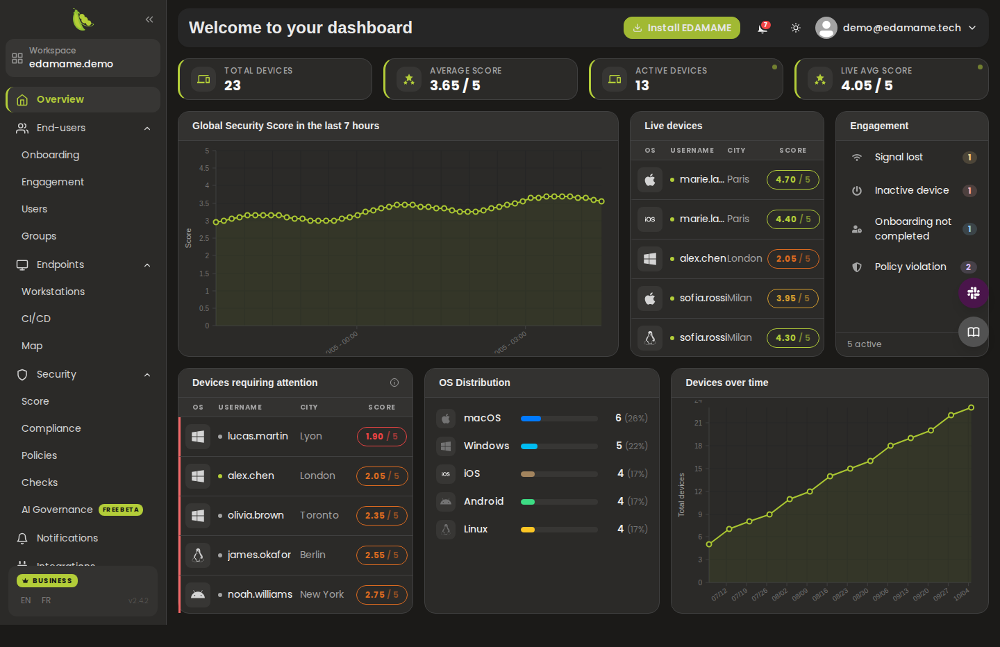
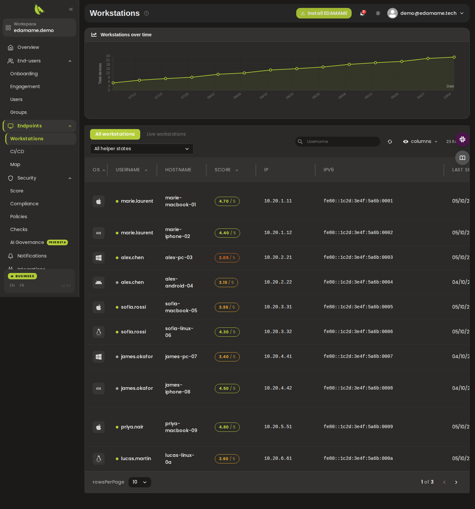
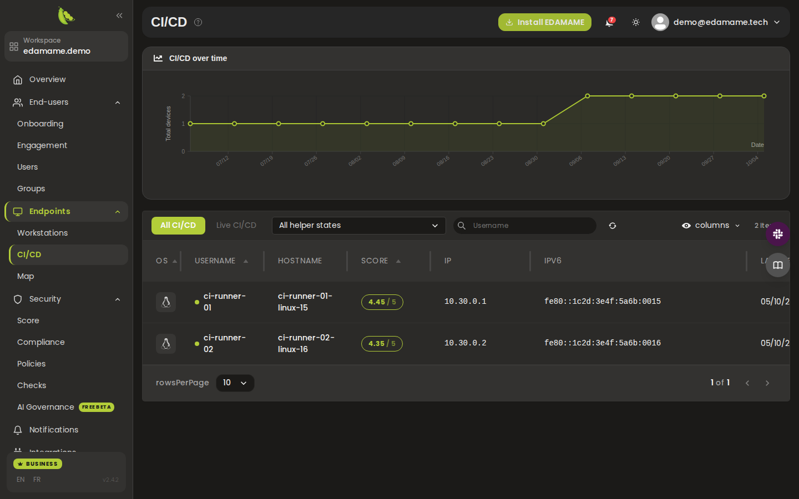
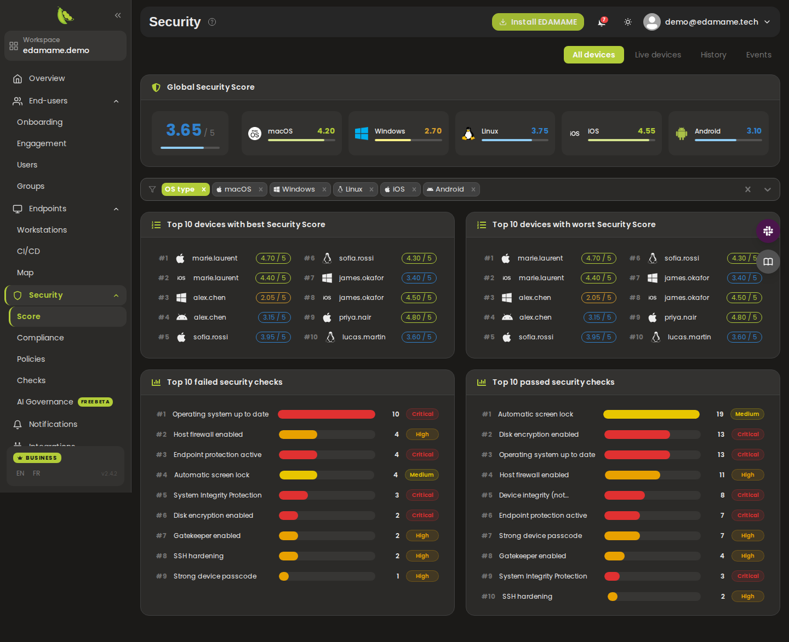
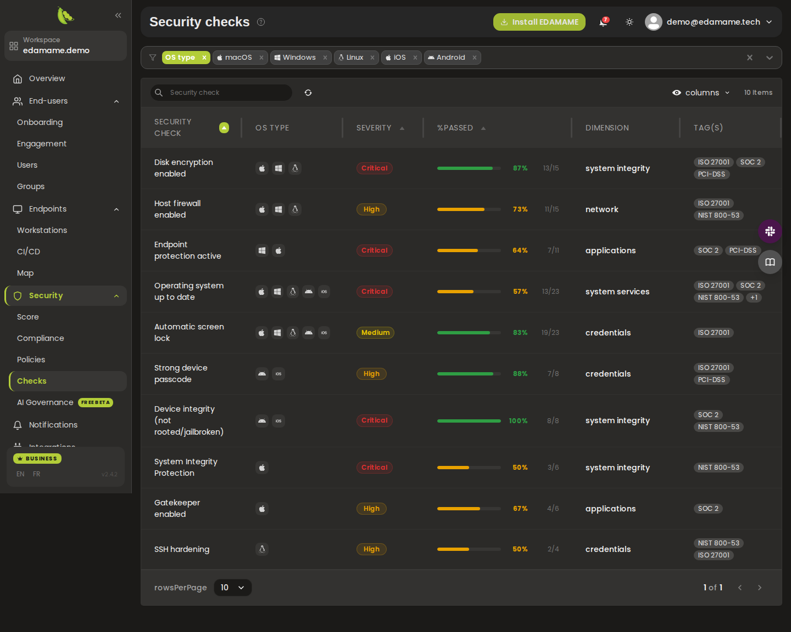
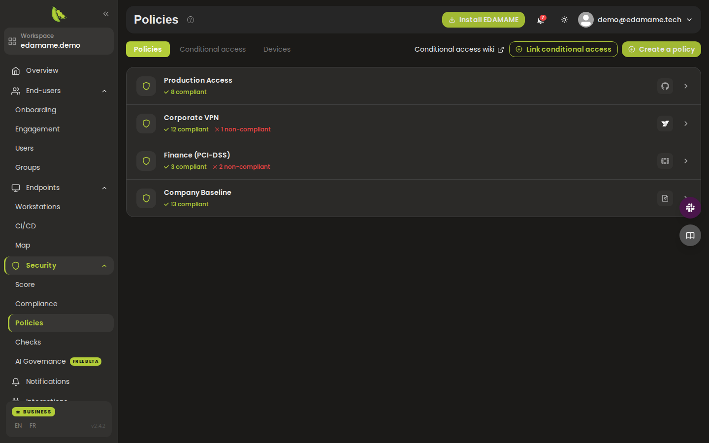
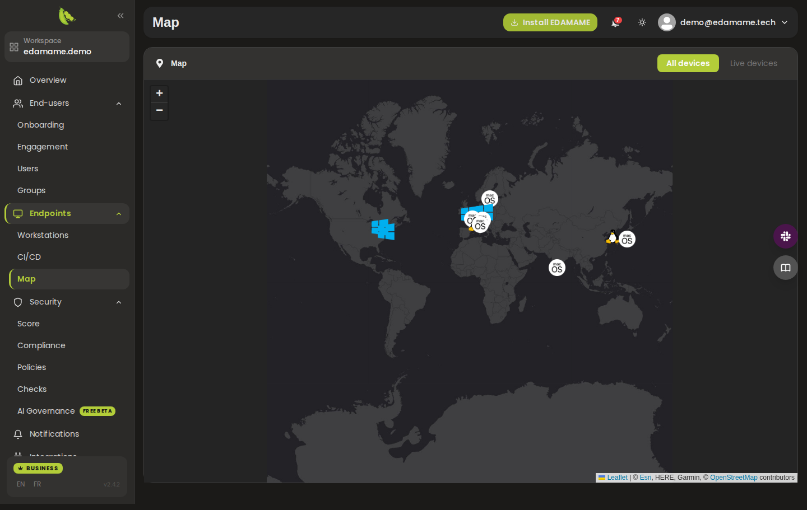

# EDAMAME Hub

> **EDAMAME** is the developer-first, agent-first runtime security layer for the SDLC. **EDAMAME Security** protects workstations and local coding sessions, **EDAMAME Posture** secures CI/CD runners, build hosts, and self-hosted agent hosts, **EDAMAME Hub** gives teams fleet visibility and proof, and **EDAMAME Portal** handles account access and managed LLM subscription.

## Overview

EDAMAME Hub is the no-MDM security dashboard for your organization. It brings
together the security posture of every developer workstation, CI/CD runner and
AI coding agent that runs EDAMAME, so you can see where you stand, prove it to
auditors and customers, and grant access to sensitive systems only to devices
that meet your policies.

The Hub is **reporting-only**: devices report their posture, and the Hub never
takes control of them. Developers, contractors and third parties keep ownership
of their machines, which makes the Hub a fit where MDM lockdown is not an option.

**Open the Hub:** [hub.edamame.tech](https://hub.edamame.tech) (free plan,
with a demo workspace you can explore before enrolling a single device)

**Learn more:** [Feature wiki](https://github.com/edamametechnologies/edamame_hub/wiki)
| [Step-by-step guides](#step-by-step-guides)
| [Zero Trust integrations](https://github.com/edamametechnologies/integrations)

## Who it is for

- **Security and IT teams** that need one view of endpoint security across
  workstations, CI/CD runners and servers, without deploying an MDM.
- **Engineering leaders** who want development environments and AI coding
  agents to meet a common bar, and to see when they drift.
- **Compliance owners** who need evidence for SOC 2, ISO 27001, PCI-DSS, HIPAA
  or CIS-based programs, per device and over time.
- **Organizations working with contractors and BYOD**, where remote control of
  a device is neither possible nor wanted.

## How it works

1. **Endpoints run EDAMAME.** Workstations and personal devices run
   [EDAMAME Security](https://github.com/edamametechnologies/edamame_security)
   (macOS, Windows, Linux, iOS, Android). CI/CD runners, build hosts and servers
   running AI agents, cloud or self-hosted, run
   [EDAMAME Posture](https://github.com/edamametechnologies/edamame_posture_cli),
   directly or through the
   [EDAMAME Posture GitHub Action](https://github.com/edamametechnologies/edamame_posture_action).
2. **Each endpoint assesses itself.** It evaluates the open
   [EDAMAME threat models](https://github.com/edamametechnologies/threatmodels)
   locally and reports its security score and check results to your Hub
   workspace.
3. **The Hub rolls it up.** Scores, checks, compliance and AI posture are
   aggregated across the fleet, compared with your policies, and turned into
   escalations, notifications and access decisions in the tools you already
   use.

## Features

### Fleet visibility

- **Overview:** total and live devices, average and live security score, score
  trend, devices requiring attention, OS distribution and fleet growth.
- **Endpoints:** separate views for workstations and CI/CD runners, with OS
  filters, live status and a per-device page (5-dimension score, failed and
  passed checks, policy compliance).
- **Users and groups:** who is enrolled, on how many devices, with what score;
  groups to target policies.
- **Map:** where your devices are, all or live only.

### Security score and checks

- A security score from 0 to 5 per device and for the whole fleet, across five
  dimensions: Credentials, Network, System Services, System Integrity and
  Applications.
- Current, live and historical views, best and worst devices, most failed and
  passed checks, and score events that show sudden changes across the fleet.
- A **Security Checks** catalog with each check's severity, pass rate,
  dimension and framework tags, and the devices that pass or fail it.

### Compliance

Pick a framework (ISO 27001, SOC 2, PCI-DSS, HIPAA, CIS, NIST and more) and see
the fleet's current, live and historical compliance rate, with per-device and
per-check rankings.

### AI Governance

See the AI coding agents running across your fleet (Cursor, Claude Code, Claude
Desktop, OpenClaw, Codex, Hermes): which agents are present, whether a
governance harness confines them, which MCP servers they reach, and which
conditions keep failing an AI posture check. Accept an expected condition once
for the whole domain, allow the agents and MCP servers you approve, and let
exceptions expire. Framework exposure maps failing AI checks to OWASP Agentic,
OWASP LLM, MITRE ATLAS and ISO/IEC 42001 items.

### Policies and conditional access

- Policies based on minimum score, required checks, compliance tags or group
  membership, with compliant and non-compliant device counts.
- **Conditional access:** grant or revoke access according to device posture
  in GitHub, GitLab, Azure, Google, FortiGate, NetBird, Tailscale, Netskope,
  or any system driven by a custom IP or MAC allow list. Setup guides:
  [integrations](https://github.com/edamametechnologies/integrations).

### Onboarding, engagement and notifications

- **Onboarding:** invite users by email or let them self-onboard, and follow who
  has connected.
- **Engagement:** escalations for lost signals, inactive devices, unfinished
  onboarding and policy violations, with a queue to work through.
- **Notifications:** new users and devices, score and compliance spikes,
  workspace limits and conditional access errors, in the Hub's notification
  center and to the email and phone recipients you choose.

### Integrations and GitHub audit

- Connect **Vanta** and **GitHub** from the Settings page.
- **[GitHub Audit](./GITHUBAUDIT.md):** a one-click security review of your
  GitHub organization's audit log (who changed what, from where, and how risky
  it was), available as soon as GitHub is connected, before any device is
  enrolled.

## Screenshots

| | |
|---|---|
|  **Endpoints:** every workstation with its score and live status |  **CI/CD:** runners enrolled through EDAMAME Posture |
|  **Security score:** fleet score per OS, best and worst devices, most failed checks |  **Security checks:** pass rate, severity and framework tags per check |
|  **Policies:** compliance per policy and the integration it controls |  **Map:** where your devices are |

These screenshots come from the production Hub on a demo workspace with
simulated data, and are refreshed automatically each time a new version of the
Hub is deployed. Every page is documented, with screenshots, in the
[feature wiki](https://github.com/edamametechnologies/edamame_hub/wiki).

## Security checks

The Hub aggregates the checks that EDAMAME Security and EDAMAME Posture
evaluate on every enrolled endpoint. Each check appears in the Security Checks
catalog with its pass rate, on each device's page, and in the Security Score
and Compliance views.

Checks come from the open-source
[EDAMAME threat models](https://github.com/edamametechnologies/threatmodels):
industry benchmarks such as CIS and NIST, mapped to ISO 27001, SOC 2, PCI-DSS
and HIPAA. They fall into four kinds:

- **System checks:** direct inspection of system configuration, files and
  settings.
- **Command-line checks:** vetted, read-only commands that report system state.
- **Business rules:** optional scripts for your organization's own policies.
- **Internal checks:** evaluated by EDAMAME itself:
  - **AI agent posture** (`unsecured_cursor`, `unsecured_claude_code`,
    `unsecured_claude_desktop`, `unsecured_openclaw`, `unsecured_codex`,
    `unsecured_hermes`), in the Applications dimension: an AI coding agent is
    installed on the endpoint while EDAMAME's monitoring of that agent is
    paused. See EDAMAME Security's
    [Agent Detection & Response](https://github.com/edamametechnologies/edamame_security#agent-visibility-agent-detection--response).
  - **EDAMAME Helper status**, in the System Services dimension: the
    privileged [helper](https://github.com/edamametechnologies/edamame_helper)
    needed for full analysis and remediation is not running or out of date.
  - **Business rules compliance:** one or more of your business rules are not
    respected.

No Hub-side setup is needed: as soon as an endpoint reports, its checks appear
in the catalog and count toward its score and your compliance.

## Getting started

1. **Sign up** at [hub.edamame.tech](https://hub.edamame.tech) and explore the
   demo workspace.
2. **Create your workspace** for your organization's domain and verify the
   domain.
3. **Onboard your users** from the Onboarding page: invite them by email or
   turn on self-onboarding. They install
   [EDAMAME Security](https://github.com/edamametechnologies/edamame_security)
   and connect it to your workspace.
4. **Enroll CI/CD runners and servers** with the
   [EDAMAME Posture GitHub Action](https://github.com/edamametechnologies/edamame_posture_action),
   the [GitLab integration](https://gitlab.com/edamametechnologies/edamame_posture_action)
   or the [EDAMAME Posture CLI](https://github.com/edamametechnologies/edamame_posture_cli).
5. **Deploy at scale through your MDM** (Intune, Configuration Manager, Jamf,
   Kandji, Mosyle, Workspace ONE) or Ansible with
   [auto_provisioning](https://github.com/edamametechnologies/auto_provisioning),
   which preconfigures Hub enrollment.
6. **Set your policies**, link conditional access to your identity, code and
   network providers, and choose your notifications.

The Hub has a free plan. Business and Enterprise plans raise the user, device
and history limits; see **Settings > Billing and plans** in the Hub.

## Step-by-step guides

The wiki walks through the common tasks screen by screen, including:

- [Invite and onboard end users](https://github.com/edamametechnologies/edamame_hub/wiki/workflow-invite_users)
- [Review your security dashboard](https://github.com/edamametechnologies/edamame_hub/wiki/workflow-review_dashboard)
- [Investigate an endpoint](https://github.com/edamametechnologies/edamame_hub/wiki/workflow-investigate_device)
- [Check compliance against a framework](https://github.com/edamametechnologies/edamame_hub/wiki/workflow-check_compliance)
- [Create a policy](https://github.com/edamametechnologies/edamame_hub/wiki/workflow-create_policy)
  and [set up conditional access](https://github.com/edamametechnologies/edamame_hub/wiki/workflow-setup_conditional_access)
- [Handle a security escalation](https://github.com/edamametechnologies/edamame_hub/wiki/workflow-handle_escalation)
- [Run a GitHub organization audit](https://github.com/edamametechnologies/edamame_hub/wiki/workflow-run_github_audit)

See the [wiki home](https://github.com/edamametechnologies/edamame_hub/wiki)
for the full list.

## EDAMAME ecosystem

- **[EDAMAME Security](https://github.com/edamametechnologies/edamame_security):** desktop and mobile app for workstations and personal devices
- **[EDAMAME Posture](https://github.com/edamametechnologies/edamame_posture_cli):** CLI for CI/CD runners, build hosts and servers
- **[EDAMAME Posture GitHub Action](https://github.com/edamametechnologies/edamame_posture_action):** posture and network controls in GitHub workflows
- **[EDAMAME Helper](https://github.com/edamametechnologies/edamame_helper):** privileged helper used by EDAMAME Security
- **[Threat models](https://github.com/edamametechnologies/threatmodels):** the open security checks every endpoint evaluates
- **[auto_provisioning](https://github.com/edamametechnologies/auto_provisioning):** MDM and Ansible deployment with preconfigured Hub enrollment
- **[Integrations](https://github.com/edamametechnologies/integrations):** conditional access setup guides per vendor
- **[EDAMAME Portal](https://portal.edamame.tech):** account access and managed LLM subscription

## About this repository

EDAMAME Hub is a hosted service and its source is closed. This repository holds
its public documentation: this README, the
[feature wiki](https://github.com/edamametechnologies/edamame_hub/wiki) and the
screenshots they use. Maintainers: see [CONTRIBUTING.md](CONTRIBUTING.md).

For questions, feedback and feature requests, contact EDAMAME Technologies
through [edamame.tech](https://www.edamame.tech).
